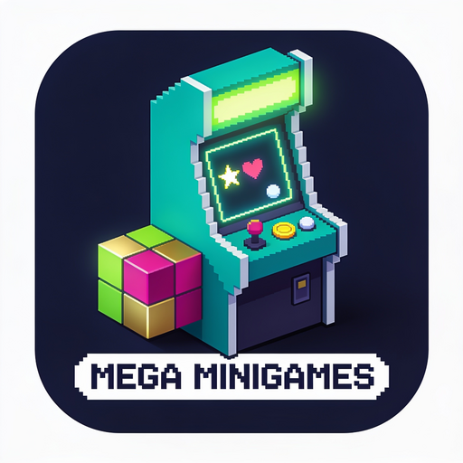

# PT-BR

### Mega MiniGames

Mod de minijogos para **Minecraft 1.20.1**, usando **Fabric** e **Java 17**. O catálogo cresce por atualizações e pode ser navegado no hub com capas clicáveis e filtros por categoria.

- **Dependências:** Fabric API 0.92.2
- **Versão alvo:** Minecraft 1.20.1
- **Loader:** Fabric

## Comando e primeiro jogo

O mod oferece **120 minijogos** em um hub paginado. Para abrir, segure o item **Console** e use-o com o botão direito. Ele aparece na aba **Ferramentas** do Criativo e também pode ser fabricado com 5 barras de ferro, 2 redstones, 1 painel de vidro e 1 botão de pedra.

# EN

### Mega MiniGames

A minigame mod for **Minecraft 1.20.1**, built using **Fabric** and **Java 17**. The catalog expands through updates and can be browsed via a hub featuring clickable covers and category-based filters.

- **Dependencies:** Fabric API 0.92.2
- **Target version:** Minecraft 1.20.1
- **Loader:** Fabric

## Command and first game The mod offers **120 minigames** within a paginated hub. To open it, hold the **Console** item and right-click. It can be found in the **Tools** tab in Creative mode and can also be crafted using 5 iron ingots, 2 redstone dust, 1 glass pane, and 1 stone button.
